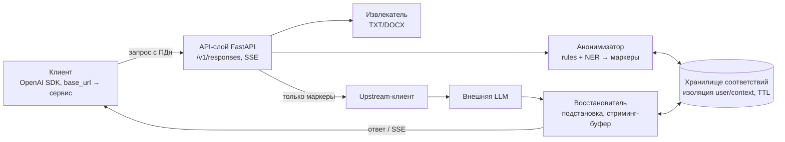

# Сервис обезличивания и деперсонализации

Проект проектного практикума магистратуры. Команда: **6 человек**.

Сервис работает как промежуточный шлюз с интерфейсом **OpenAI Responses API**: приложение отправляет запрос → сервис заменяет персональные данные устойчивыми маркерами (`PERSON_1`) → подготовленный запрос уходит во внешнюю LLM → ответ возвращается клиенту в совместимом формате, при необходимости с обратной подстановкой исходных значений.

**Статус: закрыты недели 1–2** — каркас и контракты, схемы профиля Responses API, rule-детекторы строгих форматов, датасет, хранилище соответствий, mock-LLM; 85 тестов зелёные. End-to-end конвейер собирается в неделе 3 (веха **M1**).

## Документы

| Документ | Что внутри |
|---|---|
| [docs/git-workflow.md](docs/git-workflow.md) | Ветки по неделям и ролям: полная последовательность пушей и мержей |
| [docs/weeks/](docs/weeks/) | Задачи недель (`week-01.md`, `week-02.md`, …) |
| [docs/ml/research.md](docs/ml/research.md) | Техобзор детекторов ПДн (правила, Natasha, DeepPavlov, линейка C1–C3), рекомендация гибрида |
| [docs/ml/marker-scheme.md](docs/ml/marker-scheme.md) | Схема маркеров и правила консистентности повторных упоминаний |
| [docs/ml/experiments.md](docs/ml/experiments.md) | План экспериментов по неделям, протокол прогонов |
| [docs/mapping/context-id.md](docs/mapping/context-id.md) | Вывод `context_id` по истории и пограничные случаи |
| [docs/files/README.md](docs/files/README.md) | Извлечение TXT/DOCX из inline-файлов |
| [docs/tests/plan.md](docs/tests/plan.md) | Реестр 37 интеграционных проверок с календарём |
| [dataset/README.md](dataset/README.md) | Датасет: генератор, JSONL-разметка, CSV-реестр |

## Ключевые требования (выжимка из ТЗ)

- **Профиль API:** `POST /v1/responses` — `model`, `instructions`, `input` (строка/массив), `tools`, `stream`, `store=false`; SSE для стриминга; всё неподдерживаемое (`previous_response_id`, `file_id`/`file_url`, изображения, WebSocket…) — понятная ошибка **до** обращения к модели.
- **Анонимизация:** 5 типов ПДн (персоны, телефоны, email, адреса, номера документов); повторные упоминания — одним маркером; сравнение rules / NER / гибрид с обоснованием.
- **Файлы:** `input_file` с inline `file_data` для TXT/DOCX — извлечение текста внутри сервиса; наружу не идут ни файлы, ни метаданные.
- **Два режима:** сохранение маркеров и обратная подстановка в разрешённые текстовые поля; таблица соответствий изолирована по пользователю и контексту, с TTL; неизвестные маркеры не восстанавливаются.
- **Качество:** recall ≥ 95% общий и ≥ 90% по каждому типу, precision ≥ 90% на отложенной выборке (100+ контрольных примеров, 50+ сущностей каждого типа).
- **Проверки:** 30+ интеграционных тестов; работа через OpenAI SDK с заменённым `base_url`; протокол — на локальной заглушке, один полный сценарий — с реальной моделью; замеры p50/p95 и памяти.
- **Датасет:** 300+ русскоязычных примеров с вымышленными ПДн, 30+ в виде TXT/DOCX, JSONL-разметка + CSV-реестр.
- **Сдача:** код, Docker Compose, README, матрица совместимости, датасет, тесты, скрипт оценки, отчёт об ошибках, демонстрация. Ключи и реальные тексты — вне репозитория и логов.

## Архитектура (кратко)



**Стек (проект):** Python 3.12+, FastAPI, httpx, SQLite, Natasha + pymorphy3, python-docx, pytest, Docker Compose.

## Команда и роли

| Роль | Владелец | Фокус |
|---|---|---|
| Р1. Тимлид / Backend-core | _имя_ | API-слой, SSE, upstream, Docker, CI |
| Р2. ML-инженер (детекция ПДн) | _имя_ | анонимизатор, метрики качества |
| Р3. Data-инженер (датасет) | _имя_ | 300+ примеров, разметка, контрольная выборка |
| Р4. Инженер файлов и function calling | _имя_ | TXT/DOCX, валидация ввода, инструментальные вызовы |
| Р5. Инженер восстановления и хранилища | _имя_ | обратная подстановка, изоляция, TTL |
| Р6. QA / Оценка качества | _имя_ | тесты, mock-LLM, совместимость, замеры |

## План спринтов (сводка)

| Спринт | Недели | Тема | Результат |
|---|---|---|---|
| 0 | 1 | Проектирование и инфраструктура | репо, CI, контракты, скелет сервиса |
| 1 | 2–3 | MVP без стриминга | end-to-end на mock-LLM **(M1)** |
| 2 | 4–5 | Полный профиль API + файлы | TXT/DOCX, function calling, NER-базлайн, датасет v1 |
| 3 | 6–7 | Качество и стриминг | метрики ТЗ достигнуты **(M2)**, SSE с подстановкой |
| 4 | 8–9 | Совместимость и безопасность | SDK-прогон, реальная модель, замеры, 30+ тестов **(M3)** |
| 5 | 10–11 | Стабилизация и сдача | отчёт, демо, защита |

## Структура репозитория

```
data-anonymization-KalitkaAI/
├── README.md                 # этот файл
├── docs/                     # git-workflow, задачи недель, доки направлений (ml, mapping, files, tests)
├── src/anongw/               # код сервиса (api, anonymizer, restorer, files, mapping, upstream)
├── dataset/                  # генератор, примеры, JSONL-разметка, реестр
├── tests/                    # unit- и интеграционные тесты, mock-LLM
├── docker-compose.yml
└── pyproject.toml
```

## Окружение разработки

Python 3.12+. Установка и правила контрибуции — [CONTRIBUTING.md](CONTRIBUTING.md):

```bash
python -m venv .venv
source .venv/Scripts/activate   # Windows (Git Bash); Linux: source .venv/bin/activate
pip install -e ".[dev]"
pytest -q
```

## Важные ограничения (обязательно к документации в продукте)

- Замена идентификаторов **не гарантирует анонимность**: личность может раскрыть контекст (должности, уникальные факты, суммы).
- Совместимость ограничена проверенным профилем API; защита охватывает только данные, проходящие через сервис.
- OCR, другие языки и сложная вёрстка — вне базового скоупа (расширения).
